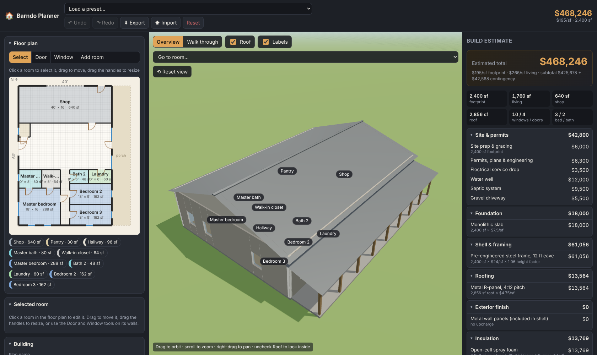

# Barndo Planner

An interactive 3D barndominium planner that runs in the browser. Lay out rooms on a
top-down floor plan, walk through the house room to room in first person, and watch
a line-item build estimate update as you change the square footage and options.



## Features

- **Editable floor plan.** Drag rooms to move them, drag the handles to resize, snap to a
  1 ft grid, and add rooms of any type (bedrooms, baths, kitchen, shop, garage, hallway…).
  Open floor area that isn't enclosed by a room is treated as the great room.
- **Doors and windows by clicking.** Pick the Door tool and click any wall to cut a doorway
  (or a wide cased opening); click an exterior wall with the Window tool to add a window.
  Click an existing opening to remove it. Overhead shop doors, French and sliding patio
  doors are supported.
- **3D model.** Walls, slab, gable roof with adjustable pitch and ridge direction, gable ends,
  ceilings, covered porches on any side, glass in windows, swung-open door leaves, stone
  wainscot and other exterior finishes.
- **Overview and walkthrough.** Orbit around the building (uncheck *Roof* for a dollhouse
  view), or switch to *Walk through* and move with W A S D / arrows while the mouse looks
  around. Wall collision keeps you in the rooms, and door openings let you move between
  them. *Go to room…* teleports you into any room; the HUD shows where you are.
- **Live cost estimate.** Every change re-runs a line-item estimator covering site work,
  foundation, shell, roofing, exterior finish, insulation, windows and doors, interior
  finish, flooring, kitchen and baths, plumbing, electrical, HVAC, porches and extras,
  with a regional multiplier and contingency. Totals are shown per square foot.
- **Presets, undo/redo, autosave, import/export.** Three starter layouts plus a blank
  footprint. Work is saved to the browser automatically and can be exported as JSON.

## Running it

**Easiest: a desktop launcher.** The `launchers/` folder has a double-clickable script for
Windows (`Barndo Planner.bat`), macOS (`Barndo Planner.command`) and Linux
(`barndo-planner.sh`). Copy the one for your system to your desktop and double-click it.
The first run downloads the code into `BarndoPlanner` in your home folder, installs the
dependencies and opens the app in your browser. After that it starts in a few seconds.
See [launchers/README.md](launchers/README.md) for details.

**From a checkout:**

```bash
npm install
npm run dev        # http://localhost:5173
```

Other scripts:

```bash
npm test           # unit tests for the geometry engine and estimator
npm run typecheck  # strict TypeScript check
npm run build      # production build into dist/
npm run preview    # serve the production build
```

The app has no backend. The production build is static files, so it can be hosted anywhere.
The included GitHub Actions workflow (`.github/workflows/deploy.yml`) publishes `main` to
GitHub Pages: enable Pages for the repository with **Source: GitHub Actions** and the site
will be served at `https://<owner>.github.io/barndo-planner/`.

## How the estimate works

`src/cost/pricing.ts` holds every unit price (dollars per square foot, per linear foot, or
per item). `src/cost/estimate.ts` turns the plan into quantities and multiplies them out:

| Quantity | Derived from |
| --- | --- |
| Footprint sf | building width × depth |
| Living sf / shop sf | footprint minus rooms typed *Shop* or *Garage* |
| Roof sf | gable geometry: span, pitch, 1.5 ft overhangs |
| Exterior wall sf | perimeter × eave height plus the two gable triangles |
| Porch sf | porch depth per side, wrapping shared corners |
| Counts | bedrooms, full/half baths, kitchens, laundry rooms, windows, exterior and interior doors |

The prices are rough national averages for a contractor-built barndominium and are meant
as a starting point. Adjust them to local bids by editing `pricing.ts`, or use the
*Regional cost multiplier* slider in the app. The number is a planning budget, not a quote.

## Project layout

```
src/
  model/       plan data types, room catalog, presets, geometry engine, state store
  cost/        pricing tables and the estimator
  three/       Three.js scene builder, viewer, first-person walk controls
  ui/          2D plan editor and the side panels
  main.ts      wires everything together
tests/         node:test unit tests (run with npm test)
```

### Geometry engine

`src/model/geometry.ts` derives walls from the plan: the four exterior walls plus
de-duplicated interior partitions along room edges, each with its door and window
openings. The same wall list drives the 2D drawing, the 3D meshes and the walkthrough
collision boxes, so what you see in the plan is exactly what you walk through.

## Keyboard shortcuts

| Key | Action |
| --- | --- |
| Ctrl/⌘ + Z, Ctrl/⌘ + Shift + Z | Undo / redo |
| Delete / Backspace | Delete the selected room |
| Arrow keys (plan selected) | Nudge the selected room 1 ft |
| Esc | Back to the Select tool / deselect; release the mouse in walk mode |
| W A S D / arrows, Shift | Walk / run in walkthrough mode |

## License

MIT
